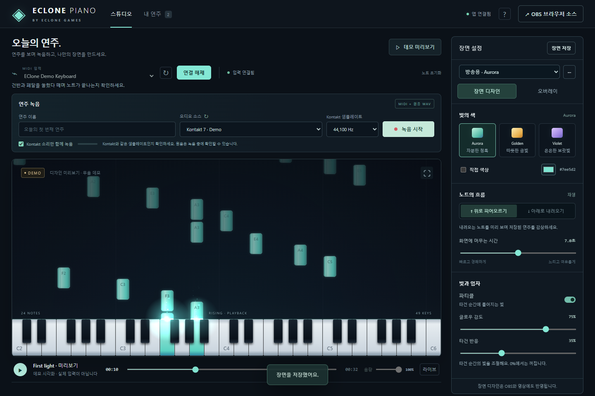
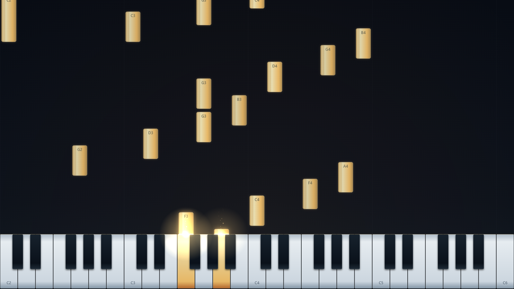
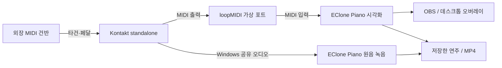

# EClone Piano

MIDI 건반 연주를 화면에 그리는 Windows 앱입니다. OBS 방송 화면, 녹음 후 다시 꾸미는 연주 영상, 클릭이 통과하는 데스크톱 오버레이로 사용할 수 있습니다. EClone Games에서 만듭니다.

A local MIDI visualizer and performance recorder for Windows, with OBS scenes, replay styling, and a click-through desktop overlay.

[](#windows-설치)
[](LICENSE)
[](https://github.com/EcchiClone/eclone-piano/actions/workflows/checks.yml)

[Windows 설치 파일 다운로드](https://github.com/EcchiClone/eclone-piano/releases/latest) · [처음 사용하는 분](docs/END_USER.md) · [Kontakt 연결](docs/SETUP.md)



계정 없이 실행하고 연주 파일을 PC에 보관합니다. 피아노 음원은 포함하지 않습니다. 실제 소리와 원음 녹음에는 Kontakt와 사용할 악기가 필요합니다.

## 무엇을 할 수 있나요?

| 사용 목적            | 제공 기능                                                                                   |
| -------------------- | ------------------------------------------------------------------------------------------- |
| **실시간 방송**      | 건반에서 위로 뻗는 노트, 벨로시티·서스테인 표시, OBS 투명 브라우저 소스                     |
| **녹음과 영상 편집** | MIDI 이벤트와 Kontakt 원음 동시 저장, 재생·탐색·디자인 변경, 하강형 노트, 1080p / 60fps MP4 |
| **데스크톱 감상**    | 모니터 선택, 항상 위·클릭 통과 오버레이, 노트와 건반의 개별 불투명도, 건반 숨기기           |

Aurora / Golden / Violet 테마와 직접 색상 지정, 글로우·파티클·타건 반응, 음 이름, 건반 높이와 표시 범위를 조절할 수 있습니다. 디자인은 이름을 붙여 저장하거나 장면 파일로 공유합니다. 저장한 연주는 검색·정렬하고 WAV·MIDI·세션 JSON으로 내려받을 수 있습니다.



_스크린샷은 앱에서 만든 데모 장면입니다. 데모는 무음이며, 실제 녹음이나 타사의 피아노 음원을 포함하지 않습니다. [시각 자료와 생성 방법](docs/images/README.md)_

> **지원 범위:** 일반 MIDI 입력으로 시각화할 수 있습니다. 원음 녹음은 현재 **Kontakt 독립 실행 앱**을 대상으로 하며 Kontakt 7에서 확인했습니다. DAW 안의 Kontakt 플러그인, 임의의 다른 앱 오디오, ASIO 직접 캡처는 지원하지 않습니다. 음원·가상악기를 내장한 프로그램은 아닙니다.

## Windows 설치

**[GitHub Releases에서 다운로드](https://github.com/EcchiClone/eclone-piano/releases/latest)** → **Windows-x64-Setup.exe**를 실행하세요. 설치 없이 실행하려면 Windows-x64.zip 전체를 압축 해제하고 EClone Piano.exe를 엽니다.

Electron·Node.js·.NET 오디오 도우미·FFmpeg·FFprobe가 포함되어 개발 도구를 따로 설치하지 않아도 됩니다. 업데이트된 Windows 10 22H2 / Windows 11 x64를 지원합니다. Kontakt·피아노 음원·건반 드라이버·loopMIDI는 별도로 준비합니다. **[설치본 사용자 가이드](docs/END_USER.md)**

서명 인증서가 없는 배포본이며, SHA256SUMS.txt로 파일을 확인할 수 있습니다. 앱은 사용자 폴더에 연주를 보관하므로 업데이트 시 프로그램 파일을 교체할 수 있습니다.

<details>
<summary>소스에서 실행하기: 개발 도구와 설치 순서</summary>

## 소스에서 실행할 때의 준비물

처음 설치할 때 인터넷이 필요합니다. 설치 후 연주·녹음·재생은 로컬에서 동작합니다.

| 구성요소                                                                               | 역할                                           | 언제 필요한가요?                                                   |
| -------------------------------------------------------------------------------------- | ---------------------------------------------- | ------------------------------------------------------------------ |
| **Windows 10 / 11, x64**                                                               | MIDI 입력과 투명 데스크톱 창                   | 앱 사용. 오디오 캡처는 업데이트된 Windows가 필요합니다.            |
| [**Node.js 22 이상**](https://nodejs.org/en/download) + npm                            | 앱 의존성 설치·실행                            | 필수. Windows x64 LTS 설치 프로그램을 사용하면 npm도 설치됩니다.   |
| **Electron**                                                                           | 별도 브라우저 없이 스튜디오·오버레이 실행      | `npm ci`가 자동 설치합니다.                                        |
| **MIDI 건반과 드라이버**                                                               | 타건·페달 정보를 PC로 전달                     | 실제 연주. 먼저 Windows에서 장치를 인식해야 합니다.                |
| **Kontakt와 사용할 악기**                                                              | 실제 피아노 소리를 재생                        | Kontakt 원음 녹음. 별도 설치·라이선스가 필요합니다.                |
| [**loopMIDI**](https://www.tobias-erichsen.de/software/loopmidi.html)                  | Kontakt에서 앱으로 MIDI를 전달하는 가상 케이블 | 아래 Kontakt 연결 방식. **소리는 전달하지 않습니다.**              |
| [**.NET 9 SDK · Windows x64**](https://dotnet.microsoft.com/en-us/download/dotnet/9.0) | 프로세스 오디오 도우미 빌드·실행               | Kontakt 원음 녹음. SDK에 필요한 런타임이 포함됩니다.               |
| [**FFmpeg + FFprobe**](https://ffmpeg.org/download.html)                               | 영상·원음을 MP4로 합치고 프레임 수 검사        | 영상 내보내기. 두 실행 파일이 있는 `bin` 폴더를 PATH에 등록합니다. |
| [**OBS Studio**](https://obsproject.com/download)                                      | 방송·방송 화면 녹화                            | OBS에 시각화를 넣을 때만 필요합니다.                               |

**MIDI 화면만 먼저 보고 싶다면:** Windows와 Node.js로 앱을 실행한 뒤 **데모 미리보기**를 누르세요. .NET·Kontakt·loopMIDI·FFmpeg·OBS는 데모에 필요하지 않습니다. 실제 MIDI 시각화도 .NET 없이 사용할 수 있습니다.

## 소스에서 실행하기 (개발용)

1. [저장소](https://github.com/EcchiClone/eclone-piano)의 **Code → Download ZIP**을 내려받아 쓰기 가능한 폴더에 압축을 풉니다. 또는 Git을 사용합니다.

   ```powershell
   git clone https://github.com/EcchiClone/eclone-piano.git
   cd eclone-piano
   ```

2. 압축을 푼 **`package.json`이 있는 폴더**에서 PowerShell을 열고 실행합니다.

   ```powershell
   npm ci
   npm run doctor
   npm start
   ```

   `doctor`는 가능한 기능과 부족한 구성요소를 알려 줍니다. 프로그램 설치나 Windows 설정 변경은 하지 않습니다. PowerShell이 `npm.ps1` 실행을 막는다면 같은 명령의 `npm` 대신 **`npm.cmd`**를 사용하세요.

3. 스튜디오에서 **데모 미리보기**로 화면을 확인합니다. Kontakt 원음도 녹음하려면 .NET 9 SDK를 설치하고, 앱을 종료한 뒤 한 번 실행합니다.

   ```powershell
   npm run setup
   npm start
   ```

   `setup`은 오디오 도우미를 빌드하고 환경을 진단합니다. 이후에는 **`EClone Piano.vbs` 더블클릭**으로 콘솔 없이 실행할 수 있습니다. Windows Script Host를 사용할 수 없는 환경에서는 `npm start`를 사용하세요.

브라우저 전용 모드는 `npm run serve` → <http://127.0.0.1:3210>입니다. 데스크톱 앱과 브라우저 전용 서버 중 **하나만 실행**하세요. 실행 중인 데스크톱 앱의 같은 주소를 브라우저에서 여는 것은 가능합니다. 전체 모니터 오버레이는 데스크톱 앱에서 지원합니다.

</details>

## 건반 → Kontakt → EClone Piano 연결

MIDI는 **어떤 음을 언제 눌렀는지**를 전달합니다. 소리는 Kontakt에서 별도로 녹음합니다.



1. **loopMIDI**를 실행합니다. `New port-name`에 **EClone Piano**를 쓰고 **+**를 누릅니다. 사용 중에는 loopMIDI를 실행해 두세요.
2. Kontakt **Options → MIDI → Inputs**에서 실제 건반 입력을 켭니다. 가상 포트 **EClone Piano 입력은 Off**로 둡니다.
3. **MIDI → Outputs**에서 **EClone Piano: On**으로 설정합니다.
4. **Engine → Send MIDI to outside world**에서 **Incoming notes**, **Incoming CCs**를 켭니다. Kontakt 화면 건반도 표시하려면 **GUI keyboard**도 켭니다. `Script generated notes / CCs`는 악기 스크립트 출력을 보고 싶을 때만 켭니다.
5. EClone Piano의 **MIDI INPUT → 새로고침 → EClone Piano → 연결**을 누릅니다.
6. 건반을 눌렀다 떼고, 서스테인 페달도 밟았다 떼어 봅니다. 노트가 나타났다가 끝나면 MIDI 연결이 된 것입니다. 짧은 테스트 녹음을 시작했을 때 입력 미터까지 반응하면 원음 연결도 확인됩니다.

가상 포트 이름은 자유롭습니다. 이전 버전에서 만든 `Luma Piano` 포트도 그대로 사용할 수 있으며, 기존 녹음·디자인·장치 설정도 유지됩니다. 새 포트가 Kontakt에 보이지 않으면 악기 상태를 저장한 뒤 Kontakt를 재실행하세요. 자세한 순서와 일반 MIDI 건반 직접 연결은 [설치·연결 가이드](docs/SETUP.md)를 참고하세요. [Kontakt 공식 옵션 설명](https://docs.native-instruments.com/online-guides/kontakt-manual/en/options-dialog)

## 세 가지 사용 방식

### 1. OBS 방송 화면

OBS **소스 → + → 브라우저**에서 `로컬 파일`을 끄고 설정합니다. [OBS 브라우저 소스 설명](https://obsproject.com/kb/browser-source)

| 항목                 | 값                                                   |
| -------------------- | ---------------------------------------------------- |
| URL                  | `http://127.0.0.1:3210/stage?transparent=1`          |
| 너비 / 높이          | `1920` / `1080`                                      |
| 사용자 지정 프레임률 | 켜기, `60`                                           |
| 실시간 Kontakt 소리  | OBS의 **응용 프로그램 오디오 캡처**에서 Kontakt 선택 |

스튜디오를 실행해 둔 상태에서 사용합니다. 브라우저 소스에는 조작 UI 없이 건반과 노트만 나오며 디자인과 재생 위치가 동기화됩니다. 라이브 연주는 **아래에서 위로** 올라갑니다.

저장한 연주의 원음도 OBS로 보내려면 스튜디오의 **OBS 브라우저 소스 → 저장된 연주 재생 시 원음도 출력**을 켜고 새 URL을 복사하세요(`&audio=1`). OBS에서 같은 소리를 브라우저와 데스크톱 오디오로 중복 수집하지 않도록 출력 경로를 하나로 정하세요.

### 2. 녹음 → 다시 꾸미기 → MP4

1. 연주 이름과 **오디오 소스**를 선택합니다. **Kontakt 소리만 함께 녹음**을 켭니다.
2. **Kontakt 샘플레이트**를 Kontakt의 **Options → Audio → Sample rate**와 똑같이 맞춥니다. `44,100` / `48,000 Hz`를 지원합니다.
3. **녹음 시작** 후 녹음 시간이 표시되고 입력 미터가 반응하는지 확인한 다음 연주합니다. MIDI만 저장하려면 오디오 체크를 끕니다.
4. **녹음 종료** 후 **내 연주**에서 재생합니다. 테마·노트 흐름·건반 범위를 바꾸거나 **아래로 내려오기**를 선택합니다. 화면에 머무는 시간은 노트 이동 표현을 바꾸며 원음의 재생속도는 유지합니다.
5. 연주 카드의 **영상 내보내기** 버튼으로 내보냅니다. 모든 프레임을 순서대로 렌더링하는 **1920×1080 / 60fps MP4**이며, 원음이 있으면 함께 포함합니다. PC 성능에 따라 연주보다 오래 걸릴 수 있습니다.

재생은 저장한 WAV를 사용합니다. MIDI만 있는 연주와 데모는 무음입니다. Kontakt 악기를 바꿔 원음을 다시 합성하는 기능은 없습니다. 스튜디오를 여러 개 열었을 때는 **재생을 시작한 스튜디오 한 곳에서만 소리**가 나며, 그 창이 연결을 잃으면 재생을 멈춥니다. 명시적으로 켠 OBS `audio=1`은 별도 출력입니다.

재생 줄의 음량·음소거는 이 창에서 듣는 소리에만 적용합니다. 원본 WAV와 내보내는 MP4의 음량은 바뀌지 않습니다. 연주 목록에서 이름으로 검색하거나 원음 유무로 걸러 보고 이름·최근 저장·길이순으로 정렬할 수 있습니다. 파일 다운로드는 각 연주의 **다운로드** 메뉴에 있습니다.

### 3. 데스크톱 오버레이

데스크톱 앱 오른쪽의 **오버레이** 탭에서 모니터를 고르고 **오버레이 켜기**를 누릅니다. 다른 프로그램 위에 표시되며 건반 영역까지 마우스 클릭이 통과합니다. 켜짐 상태는 탭 안에 표시합니다.

- **노트 불투명도 / 건반 불투명도**를 각각 조절합니다. 초기값은 `60% / 18%`입니다.
- **오버레이 건반 표시**를 끄면 화면 맨 아래에서 노트만 올라옵니다.
- **Ctrl + Shift + F10**: 오버레이 켜기·끄기.
- **Ctrl + Shift + F12**: 오버레이 닫고 스튜디오로 돌아오기.

오버레이 전용 불투명도는 OBS와 MP4에 영향을 주지 않습니다. 다른 앱이 단축키를 먼저 사용한 경우 스튜디오 버튼으로 닫을 수 있습니다.

## 장면 꾸미기와 저장

오른쪽 **장면 디자인** 탭에서 바꿉니다. 설정은 연결된 미리보기와 OBS·오버레이에 바로 반영됩니다.

- **빛의 색:** 세 테마 중 고르거나 **직접 색상**으로 원하는 색을 지정합니다.
- **빛과 입자:** 파티클·글로우·타건 반응을 조절합니다. 타건 반응을 `0%`로 두면 타건 순간의 빛 파동을 끕니다.
- **건반과 범위:** 88 / 61 / 49 / 37건반 또는 직접 지정한 음역을 표시합니다. **연주에 맞추기**는 현재 연주의 음역을 화면에 맞춥니다. 표시 범위만 바뀌며 MIDI 음높이는 유지합니다.
- **장면 저장:** 이름을 붙여 최대 12개까지 보관합니다. 같은 이름으로 저장하면 교체합니다. 옆의 `…` 메뉴에서 장면 파일 내보내기·가져오기·목록에서 삭제·디자인 초기화를 할 수 있습니다.

장면 목록과 재생 음량은 현재 앱 또는 브라우저 프로필에 저장합니다. 다른 브라우저나 PC로 옮길 때는 장면 JSON을 내보내고 가져오세요. 장면 파일에는 디자인 설정만 담으며 녹음 파일과 녹음 샘플레이트는 담지 않습니다.

## 연주 파일과 백업

**설치본·ZIP은 `%APPDATA%\EClone Piano\recordings`**, 소스 실행은 프로젝트의 **`recordings/`**에 저장합니다. 앱의 **저장 폴더** 버튼으로 열 수 있습니다.

| 파일                               | 내용                                               |
| ---------------------------------- | -------------------------------------------------- |
| `<id>.session.json`                | MIDI 이벤트, 연주 이름, 디자인, 타이밍 정보        |
| `<id>.wav`                         | 원음. Stereo / 16-bit PCM, 선택한 44.1 또는 48 kHz |
| `.mid` 다운로드                    | 다른 MIDI 도구에서 사용할 표준 MIDI 파일           |
| 내보낸 `.mp4`                      | H.264 영상과 원음이 있는 경우 AAC 오디오           |
| `settings.json`, `connection.json` | 앱 디자인과 마지막 연결 장치 설정                  |

다른 PC로 옮길 때는 앱을 종료한 뒤 **`recordings/` 전체를 백업**하거나 같은 `<id>`의 JSON과 WAV를 함께 복사하세요. **세션 가져오기**는 JSON의 MIDI 데이터를 가져오며 WAV는 포함하지 않습니다. 일반 `.mid` 파일 가져오기는 아직 지원하지 않습니다.

연주 **삭제**는 원본 JSON·WAV·MIDI를 `recordings/.trash/`로 이동합니다. 이미 내보낸 영상은 보존합니다. 복원하려면 앱을 종료하고 해당 휴지통 폴더의 같은 ID 파일들을 `recordings/`로 되돌리세요. 기존 파일과 ID가 겹치면 덮어쓰지 말고 먼저 백업하세요.

## 문제 해결

| 증상                                  | 먼저 확인할 것                                                                                                   |
| ------------------------------------- | ---------------------------------------------------------------------------------------------------------------- |
| `npm`, `dotnet`, `ffmpeg`를 찾지 못함 | 설치·PATH 등록 후 터미널과 앱을 다시 엽니다. `npm run doctor`를 실행합니다.                                      |
| MIDI 입력이 없거나 열리지 않음        | 건반 드라이버·loopMIDI 실행·포트 새로고침을 확인합니다. 다른 앱이 물리 포트를 독점하면 가상 포트로 연결합니다.   |
| 음을 떼도 노트가 남음                 | **노트 초기화**를 누르고 Incoming CCs와 페달 해제 신호를 확인합니다.                                             |
| 소리는 나지만 녹음 미터가 조용함      | Kontakt의 **WASAPI (Shared Mode)** 출력으로 확인합니다. ASIO·독점 모드는 캡처 경로를 우회할 수 있습니다.         |
| Kontakt 재시작 후 녹음 소스가 없음    | 오디오 소스를 새로고침합니다. 단일 새 인스턴스는 녹음 직전에 자동 갱신하고, 여러 개면 직접 선택합니다.           |
| 새 녹음에 주기적인 틱이 생김          | Kontakt와 녹음 샘플레이트가 같은지 확인합니다. 기존 파일에 들어간 잡음은 설정 변경으로 복원되지 않습니다.        |
| 특정 플레이어에서만 왜곡됨            | 동일 WAV·MP4를 다른 플레이어와 비교하고 음량 증폭·이퀄라이저·음장 효과를 확인합니다.                             |
| 영상 생성이 느리거나 실패함           | FFmpeg·FFprobe와 H.264 인코더 지원을 확인합니다. 데스크톱 앱에서 시도하고, 렌더링이 끝날 때까지 앱을 유지합니다. |
| 실행 시 포트 사용 중 오류             | `3210`을 쓰는 다른 EClone Piano 앱/서버를 종료합니다.                                                            |

[자세한 설치·연결](docs/SETUP.md) · [프로젝트 구조·개발 및 테스트](docs/DEVELOPMENT.md) · [검증 범위](docs/VALIDATION.md) · [사용성 검토와 개선 후보](docs/UX-REVIEW.md)

## 개발과 라이선스

Electron + Node.js + Canvas 2D, WinMM MIDI 브리지, C# WASAPI 프로세스 오디오 캡처로 구성합니다. 서버는 `127.0.0.1`에만 바인딩됩니다. 개인 녹음·의존성·임시 자료는 Git에서 제외합니다. Windows 설치 EXE와 실행 ZIP은 [Releases](https://github.com/EcchiClone/eclone-piano/releases)에 있습니다. [배포본 빌드 방법](docs/RELEASING.md)도 제공합니다.

```powershell
npm test
npm run check
npm run test:ui
npm run test:export
```

버그 제보에는 Windows 버전, 연결 방식, 재현 순서, 오류 문구와 `npm run doctor` 결과를 남겨 주세요. 진단 출력의 개인 폴더 경로는 지워도 됩니다. 실제 연주 파일은 필요한 경우에만 직접 첨부하세요.

**[MIT License](LICENSE) · Copyright © 2026 EClone Games.** Kontakt, loopMIDI, OBS, FFmpeg 및 각 의존성은 해당 제작자의 별도 라이선스를 따릅니다. 이 프로젝트는 Native Instruments와 제휴한 제품이 아닙니다.
