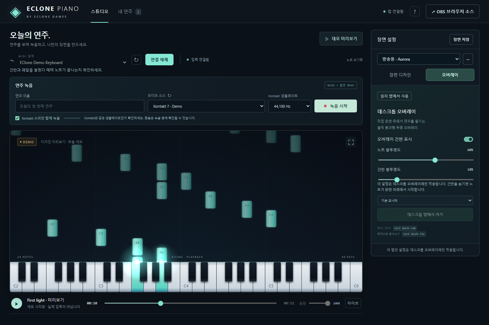

# 사용성 검토와 개선 후보

2026-11-07 기준으로 스튜디오, 연결, 녹음, 재생, 보관함, 장면 설정, 오버레이, OBS, 영상 내보내기와 공개 문서를 살펴봤습니다. 현재 코드를 읽고 합성 연주로 화면과 조작을 확인한 개발 검토입니다. 여러 사용자를 대상으로 한 사용성 조사 결과는 아닙니다.

## 이번에 반영한 내용

| 요소           | 불편할 수 있었던 점                                               | 반영 내용                                                                                          |
| -------------- | ----------------------------------------------------------------- | -------------------------------------------------------------------------------------------------- |
| 화면 순서      | 큰 미리보기 아래까지 내려가야 녹음을 시작할 수 있었음             | MIDI 연결과 녹음을 미리보기 위에 배치. 1366×768에서도 녹음 버튼이 첫 화면에 표시됨                 |
| 화면 높이      | 화면 크기에 비해 미리보기가 커서 재생 조작을 찾기 어려움          | 데스크톱 미리보기 높이를 창 높이에 맞춤. 전체 화면·OBS·오버레이 크기는 별도 유지                   |
| 상단 메뉴      | 스튜디오로 이동하려다 재생 상태를 바꿀 수 있었음                  | 스튜디오 메뉴는 화면 이동만 수행. 라이브 전환은 재생 줄의 별도 버튼으로 제공                       |
| 연결 안내      | 오류가 작은 상태 표시의 툴팁에만 나타남                           | 연결 설명·오류를 장치 선택 아래에 표시. 장치가 없으면 연결 버튼을 비활성화                         |
| 녹음 준비      | MIDI만 저장하면 소리가 없다는 사실을 놓치기 쉬움                  | 녹음 형식과 안내를 원음 포함 여부에 맞춰 변경. 샘플레이트 일치 안내를 녹음 버튼 근처에 배치        |
| 입력 레벨      | 녹음 중 미터만으로 입력 크기를 판단하기 어려움                    | dBFS 표시와 높은 입력에 대한 안내 추가. 원음 자체에 리미터나 음량 변경을 적용하지 않음             |
| 장면 설정      | 오버레이 전용 옵션과 모든 출력에 적용되는 디자인이 한 목록에 섞임 | 장면 디자인·오버레이 탭으로 구분. 적용 대상 설명 추가                                              |
| 반복 작업      | 원하는 디자인으로 돌아가려면 여러 값을 다시 조절해야 함           | 이름을 붙인 장면 저장, 재적용, 파일 내보내기·가져오기, 디자인 초기화                               |
| 색상 선택      | 세 테마 이외의 색상을 고를 수 없음                                | 직접 색상 지정. 기본 테마도 계속 선택 가능                                                         |
| 타건 느낌      | 글로우와 파티클 이외의 순간 반응을 조절할 수 없음                 | 짧게 퍼지는 타건 파동과 강도 조절 추가. 0%로 끌 수 있고 영상에서도 같은 시각에 같은 모양을 그림    |
| 건반 구성      | 네 가지 범위와 고정 높이로만 맞춰야 함                            | 건반 높이, 직접 지정한 음역, 현재 연주에 맞춘 표시 범위 제공                                       |
| 재생 음량      | 시스템 음량이나 원본을 바꿔야 조용히 들을 수 있었음               | 이 창의 재생 음량·음소거 추가. WAV·영상 출력 음량과 구분해 안내                                    |
| 연주 찾기      | 파일이 늘어나면 목록에서 눈으로 찾아야 함                         | 이름 검색, 원음 유무 필터, 최근 저장·이름·길이 정렬                                                |
| 목록 밀도      | 다운로드 링크와 삭제가 재생·내보내기와 비슷한 비중을 차지함       | 파일 링크를 다운로드 메뉴로 묶고, 날짜·길이·원음 유무를 간결하게 표시                              |
| 오버레이 상태  | 단축키나 창 종료 후 버튼만 보고 켜짐 여부를 알기 어려움           | Electron 창 상태를 스튜디오에 전달해 버튼·켜짐 표시를 갱신                                         |
| 작은 화면      | 설정과 목록의 가로 넘침, 숨겨진 안내를 놓칠 수 있음               | 390px 폭까지 줄바꿈 검사. 녹음 안내 유지. 메뉴는 바깥 클릭·Escape로 닫힘                           |
| 키보드 조작    | Space 재생 단축키가 메뉴 조작과 충돌할 수 있음                    | 입력창·메뉴·수정키 조합에서는 재생 단축키를 가로채지 않음. 설정 탭은 방향키로 이동                 |
| 화면 움직임    | 버튼·상태 효과를 줄일 방법이 없음                                 | 운영체제의 움직임 줄이기 설정에서 UI 전환과 녹음 표시의 점멸을 줄임                                |
| README 첫 화면 | 한국어 설명과 다운로드 전에 큰 이미지와 개발 정보가 나옴          | 용도·다운로드·입문 가이드를 위에 배치하고 개발용 설치는 접을 수 있게 구성. 현재 화면 이미지로 교체 |

## 다음에 검토할 항목

아래는 아직 구현하지 않은 후보입니다. 우선순위는 예상되는 불편과 변경 범위를 기준으로 정했습니다. 실제 사용 의견에 따라 순서를 바꿀 수 있습니다.

| 우선순위 | 요소          | 제안과 이유                                                                                                             |
| -------- | ------------- | ----------------------------------------------------------------------------------------------------------------------- |
| 높음     | 첫 연결       | MIDI 입력 → Kontakt 출력 → 원음 미터를 단계별로 확인하는 첫 실행 가이드. 현재는 외부 프로그램 설정을 문서와 대조해야 함 |
| 높음     | 원음 확인     | 녹음을 시작하지 않아도 짧게 입력 레벨을 확인하는 기능. 별도 캡처의 자원·종료 처리를 먼저 설계해야 함                    |
| 높음     | 휴지통        | 삭제 직후 되돌리기, 휴지통 목록과 복원 버튼. 현재는 원본을 보관하지만 파일을 직접 복원해야 함                           |
| 높음     | 연주 이름     | 저장 후 이름 변경. 파일 ID와 원음 연결을 유지하면서 이름만 고칠 수 있어야 함                                            |
| 높음     | 연주 이동     | 세션 JSON과 WAV를 한 묶음으로 내보내고 가져오기. 현재 JSON만 가져오면 원음이 따라오지 않음                              |
| 높음     | 영상 진행     | 예상 남은 시간과 단계별 진행 표시. 긴 연주를 내보내는 동안 완료 시점을 판단하기 어려움                                  |
| 보통     | 영상 옵션     | 720p/1080p, 30/60fps, 화면 비율 선택. 방송용과 편집용의 렌더링 시간·용량 요구가 다름                                    |
| 보통     | 투명 영상     | 알파 채널을 지원하는 영상 형식 검토. 현재 MP4는 투명 배경을 보존하지 못하므로 편집용 선택지에 제한이 있음               |
| 보통     | 연주 편집     | 앞뒤 무음 자르기와 MIDI·원음 동기 오프셋. 비파괴 편집부터 시작해 원본을 보존하는 방식이 적합                            |
| 보통     | 장면 보관     | Electron과 외부 브라우저에서 같은 장면 목록 사용. 현재 목록은 프로필별이며 파일로 옮겨야 함                             |
| 보통     | 장면 상태     | 적용한 장면에서 값을 바꾸면 수정됨 표시. 저장 전 상태와 저장본을 구분하기 쉬워짐                                        |
| 보통     | 오버레이 배치 | 전체 화면 외에 위치·높이·여백 지정, 모니터 제거 시 복귀 정책. 자주 쓰는 앱의 하단 UI를 피할 수 있음                     |
| 보통     | 단축키        | 녹음·정지·초기화 단축키와 키 재지정. 다른 방송 도구와 충돌할 때 사용자가 해결할 수 있어야 함                            |
| 보통     | 입력 표현     | 채널·손·벨로시티별 색상, 건반 스킨, 파티클 종류. 장면 파일 버전 호환도 함께 검토                                        |
| 보통     | 접근성        | 직접 지정한 색상의 대비 안내와 Canvas 효과를 별도로 줄이는 옵션. 현재 움직임 줄이기는 UI 효과에만 적용됨                |
| 보통     | 다중 Kontakt  | 프로세스 ID 외에 악기·창 정보를 제공할 수 있는지 검토. 한 인스턴스에서는 ID를 숨겼지만 여러 개면 구별이 어려울 수 있음  |
| 보통     | MIDI 가져오기 | 표준 .mid 파일의 템포·트랙·채널 처리. 현재는 .mid 내보내기와 앱 세션 JSON 가져오기만 지원                               |
| 낮음     | 목록 탐색     | 연주가 매우 많을 때 페이지 나누기·선택 작업·보관 용량 표시. 현재 검색과 정렬은 읽어 온 전체 목록에 적용됨               |
| 낮음     | 내보내기 작업 | 여러 연주 순차 내보내기와 재시도. 현재는 한 작업을 끝내거나 취소한 뒤 다음 작업을 시작해야 함                           |
| 낮음     | 배포          | 코드 서명·업데이트 안내·버전 비교. 현재는 사용자가 Releases에서 내려받아 교체하는 방식                                  |

## 확인 범위와 남은 제한

레이아웃·검색·정렬·음량·장면 파일과 이름 처리·탭 조작은 합성 데이터로 검사했습니다. 타건 반응은 같은 재생 시각에서 결과가 같은지, 짧은 반응 뒤 사라지는지도 확인했습니다. 실제 타건의 느낌이나 색상 취향은 사용자의 피드백이 더 필요합니다.

현재 원음 녹음 대상은 Kontakt 독립 실행 앱입니다. DAW 플러그인·다른 앱·ASIO 직접 캡처 지원은 이번 화면 개선에 포함하지 않았습니다. 다중 모니터, 드라이버, 실제 음질과 물리적 클릭 통과는 자동 화면 검사만으로 판단할 수 없습니다. [검증 기록](VALIDATION.md)과 [사용자 가이드](END_USER.md)에 범위를 구분했습니다.
